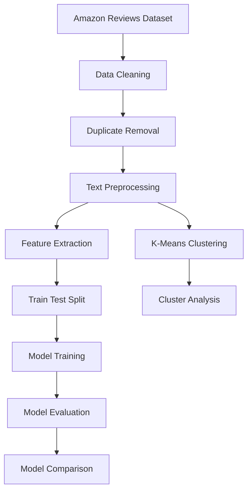

# 📊 Amazon Review Sentiment Analysis using PySpark

An end-to-end sentiment analysis project built using **Apache Spark (PySpark)** to process, analyze, and classify Amazon product reviews. The project explores scalable data processing, text preprocessing, machine learning model comparison, and unsupervised clustering to extract insights from customer reviews.

---

## 🚀 Project Overview

Customer reviews provide valuable insights into product quality and customer satisfaction. This project uses PySpark to analyze Amazon reviews, preprocess textual data, and classify reviews into positive, negative, and neutral sentiments.

Multiple machine learning algorithms are trained and evaluated to identify the best-performing model for sentiment classification.

### Objectives

- Process and analyze Amazon reviews using PySpark.
- Clean and preprocess textual data.
- Convert text into machine-readable feature vectors.
- Classify reviews into sentiment categories.
- Compare machine learning models.
- Explore customer review patterns through K-Means clustering.

---

## 🛠️ Tech Stack

| Technology | Purpose |
|---|---|
| Python | Programming language |
| Apache Spark | Distributed data processing |
| PySpark | Spark-based machine learning and data processing |
| Pandas | Data analysis |
| NumPy | Numerical operations |
| Matplotlib | Visualization |
| Seaborn | Statistical visualization |
| Jupyter Notebook | Interactive analysis |

---

## 📂 Dataset

The project uses a sample of the **Amazon Reviews dataset**.

- **Total sampled reviews:** 20,000
- **Duplicate records identified:** 36

### Sentiment Distribution

| Sentiment | Reviews | Percentage |
|---|---:|---:|
| Positive | 14,939 | 74.83% |
| Negative | 3,103 | 15.54% |
| Neutral | 1,922 | 9.63% |
| **Total** | **19,964** | **100%** |

The sentiment distribution indicates that positive reviews dominate the dataset, making class distribution an important consideration during model evaluation.

---

## 🔄 Project Workflow



### 1. Data Preprocessing

- Removed duplicate records.
- Cleaned and prepared review text.
- Prepared sentiment labels.
- Converted text into numerical features suitable for machine learning.

### 2. Feature Engineering

Text data was transformed into numerical representations using Spark's text-processing pipeline to enable machine learning algorithms to work with textual reviews.

### 3. Train-Test Split

The dataset was divided into training and testing subsets:

- **Training data:** 16,093 records
- **Testing data:** 3,871 records

### 4. Model Training

The following machine learning algorithms were implemented and evaluated:

- Logistic Regression
- Naive Bayes
- Decision Tree Classifier
- Random Forest Classifier

### 5. Model Evaluation

Models were evaluated using classification performance metrics, including:

- Accuracy
- F1-score

---

## 📈 Machine Learning Results

| Model | Accuracy |
|---|---:|
| Logistic Regression | **82.87%** |
| Naive Bayes | 77.84% |
| Decision Tree | 79.59% |
| Random Forest | 75.36% |

### 🏆 Best Performing Model: Logistic Regression

Logistic Regression achieved the highest accuracy of **82.87%** with an F1-score of **0.8192** among the evaluated models.

Its performance suggests that a linear classification approach is effective for the feature representation used in this sentiment analysis task.

---

## 🔍 Unsupervised Learning: K-Means Clustering

K-Means clustering was also explored to identify patterns in customer reviews without relying on sentiment labels during clustering.

The clustering experiment was performed on a sample of 1,000 reviews.

### Cluster Distribution

| Cluster | Reviews |
|---|---:|
| Cluster 0 | 996 |
| Cluster 1 | 1 |
| Cluster 2 | 1 |
| Cluster 3 | 1 |
| Cluster 4 | 1 |

The clustering results revealed a highly imbalanced cluster distribution. This highlights the importance of evaluating feature representations, scaling, and clustering parameters when applying unsupervised learning to text data.

---

## 📊 Key Insights

- Approximately 75% of the sampled reviews were positive.
- Logistic Regression outperformed the other evaluated classification models.
- The classification pipeline achieved an accuracy of 82.87%.
- The F1-score of 0.8192 provides an additional perspective on classification performance.
- K-Means produced highly imbalanced clusters, indicating scope for experimentation with alternative feature representations and clustering configurations.

---

## 📁 Project Structure

```text
Cluster project/
│
├── notebooks/
│   └── sentiment_analysis.ipynb
│
├── test_spark.py
├── README.md
├── requirements.txt
└── .gitignore
```

*The structure above is illustrative. Adjust the paths to match the actual files in your repository.*

---

## ⚙️ Installation and Setup

### Prerequisites

- Python 3.10+
- Java
- Apache Spark / PySpark
- Jupyter Notebook

### 1. Clone the repository

```bash
git clone https://github.com/YOUR_USERNAME/spark-sentiment-analysis.git
cd spark-sentiment-analysis
```

### 2. Create a virtual environment

```bash
python -m venv .venv
```

### 3. Activate it

**Windows PowerShell:**

```powershell
.\.venv\Scripts\Activate.ps1
```

### 4. Install dependencies

```bash
pip install pyspark pandas numpy matplotlib seaborn jupyter
```

### 5. Launch Jupyter Notebook

```bash
jupyter notebook
```

---

## 🔮 Future Improvements

- Experiment with TF-IDF feature representations.
- Improve K-Means clustering performance.
- Explore hyperparameter tuning.
- Implement cross-validation.
- Explore advanced NLP models.
- Experiment with deep learning-based sentiment classification.
- Develop an interactive sentiment analysis dashboard.

---

## 👨‍💻 Author

**Ayush Pandey**

B.Tech Computer Science and Engineering | Data Science

Interested in Data Analytics, Machine Learning, Big Data, and AI.

---

⭐ If you find this project interesting, feel free to explore the repository.
